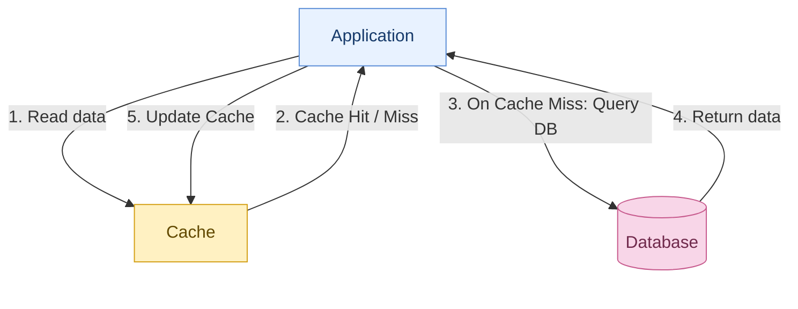
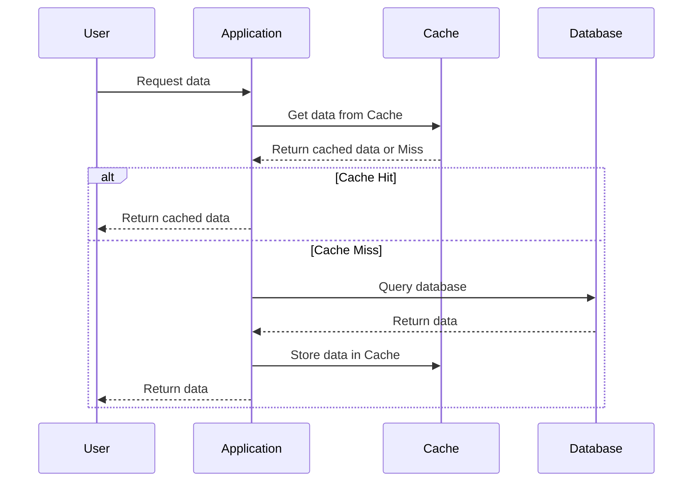

## Todos:

- [x] Complete the theory

- [ ] Write app.py for demo

- [ ] Emulate:
  - [ ] Low speed database
  - [ ] Đọc Redis trước
  - [ ] Khi miss thì đọc database giả lập, ghi cache có TTL và trả dữ liệu
  - [ ] Khi hit thì trả trực tiếp
  - [ ] Dùng bộ đếm thời gian
  - [ ] Thêm lệnh xóa cache và chạy nhiều lần để lấy kết quả ổn định

## Cache-Aside (Lazy Loading)

### Cache Hit và Cache Miss

- **Cache Hit** xảy ra khi dữ liệu được yêu cầu đã tồn tại và còn hợp lệ trong cache. Khi đó, hệ thống có thể truy xuất dữ liệu trực tiếp từ cache thay vì phải truy vấn database. Điều này giúp rút ngắn thời gian phản hồi, giảm tải cho database và cải thiện hiệu năng tổng thể của hệ thống.

- **Cache Miss** xảy ra khi dữ liệu được yêu cầu không tồn tại hoặc không còn hợp lệ trong cache. Khi đó, hệ thống thường phải truy vấn database để lấy dữ liệu nhằm đáp ứng yêu cầu. Quá trình này thường mất nhiều thời gian hơn so với Cache Hit, đồng thời làm tăng số lượng truy vấn đến database và ảnh hưởng đến hiệu năng hệ thống.

### **Cache Aside (Lazy Loading) Pattern**

- **Cache Aside** hay **Lazy Loading** là một chiến lược quản lý caching được dùng trong system design để quản lí dữ liệu hiệu quả hơn và cải thiện hiệu năng của hệ thống. Trong mô hình này, khi ứng dụng cần data, nó sẽ kiểm tra cache trước. Nếu data được tìm thấy (cache hit) thì nó sẽ trả về ngay lập tức. Ngược lại, khi data không được tìm thấy trong cache (cache miss), ứng dụng sẽ truy vấn database để lấy data, sau đó lưu trữ data vào cache để sử dụng cho các lần truy vấn tiếp theo.

| Chiến lược                 | Cách hoạt động                                                                                                                                        |
| -------------------------- | ----------------------------------------------------------------------------------------------------------------------------------------------------- |
| Cache-Aside (Lazy Loading) | Ứng dụng kiểm tra cache trước. Nếu cache miss, ứng dụng truy vấn database và lưu dữ liệu vào cache.                                                   |
| Read-Through               | Ứng dụng đọc dữ liệu từ cache. Nếu cache miss, cache layer tự động truy vấn database và lưu kết quả vào cache.                                        |
| Write-Through              | Khi ghi dữ liệu, ứng dụng ghi thông qua cache layer, sau đó dữ liệu được cập nhật đồng bộ (synchronous) vào database trước khi hoàn tất thao tác ghi. |
| Write-Behind (Write-Back)  | Ứng dụng ghi dữ liệu vào cache trước, sau đó dữ liệu được cập nhật bất đồng bộ (asynchronous) vào database.                                           |
| Write-Around               | Ứng dụng ghi dữ liệu trực tiếp vào database mà không thông qua cache layer.                                                                           |

### Cache Invalidation and Time To Live (TTL)

- **Stale data** hiện tượng dữ liệu trong cache đã cũ và không còn khớp với dữ liệu hiện tại trong database. Điều này thường xảy ra khi database được cập nhật nhưng cache chưa được xóa hoặc làm mới.

- **Cache invalidation** là quá trình loại bỏ hoặc cập nhật dữ liệu trong cache. Nó giúp đảm bảo ứng dụng luôn truy xuất dữ liệu mới nhất từ database, tránh việc sử dụng dữ liệu cũ hoặc không chính xác, giúp giải quyết vấn đề stale data. Cache invalidation có thể được thực hiện bằng một số phương pháp như: key-based, time-based, write-through, write-behind...

- **Time To Live** là khoảng thời gian mà dữ liệu được phép tồn tại trong cache trước khi tự động hết hạn. TTL giúp kiểm soát thời gian lưu trữ dữ liệu, hạn chế sử dụng dữ liệu quá cũ và giải phóng bộ nhớ cache.

- TTL trong cache invalidation: Dữ liệu được cache sẽ được gán một TTL nhất định. Khi TTL hết hạn, dữ liệu sẽ được loại bỏ khỏi cache hoặc đánh dấu là không hợp lệ, buộc ứng dụng phải truy vấn lại database để lấy dữ liệu mới. Điều này giúp giảm nguy cơ stale data và đảm bảo rằng dữ liệu trong cache luôn được cập nhật.

### Một số vấn đề với cache

- **Cache penetration** xảy ra khi ứng dụng liên tục nhận những request truy vấn dữ liệu không tồn tại trong cả cache lẫn database. Do dữ liệu không tồn tại, mỗi request đều gây ra cache miss và tiếp tục truy vấn database. Nếu số lượng request quá lớn, database có thể bị quá tải dù hệ thống đã triển khai caching.

Giải pháp: negative caching, dùng rate limiter, bloom filter...

- **Cache stampede** xảy ra khi một dữ liệu phổ biến trong cache hết hạn và có nhiều request đồng thời truy cập dữ liệu đó. Khi cache của data hết TTL, tất cả request có thể đồng thời gặp cache miss và cùng truy vấn database để lấy lại thông tin. Điều này khiến database phải xử lý nhiều truy vấn giống nhau trong cùng một thời điểm.

Giải pháp: cài đặt worker update cache thường xuyên, dùng lock để chỉ cho phép một request truy vấn database và các request khác chờ,...

- **Cache avalanche** xảy ra khi một số lượng lớn dữ liệu trong Cache hết hạn gần như cùng lúc, hoặc khi Redis gặp sự cố khiến nhiều dữ liệu không thể truy cập được. Khi đó, nhiều request phải chuyển sang truy vấn database, tạo ra sự gia tăng đột ngột về tải và có thể khiến database quá tải.

Giải pháp: Dùng TTL Jitter, tức là thêm một khoảng thời gian ngẫu nhiên vào TTL của các dữ liệu trong cache để tránh việc nhiều dữ liệu hết hạn cùng lúc.

### Demo Cache-Aside với Redis
