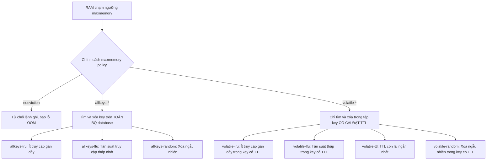

# Quản lý Bộ nhớ và Cơ chế Eviction trong Redis

## 1. Cơ chế Giới hạn Bộ nhớ (`maxmemory`)

### 1.1. Khái niệm và Vai trò
Redis là một hệ thống lưu trữ dữ liệu hoàn toàn trên bộ nhớ RAM (In-Memory Data Store). Do RAM là tài nguyên hữu hạn và có chi phí đắt đỏ hơn nhiều so với ổ đĩa, Redis cung cấp cơ chế giới hạn dung lượng RAM tối đa mà tiến trình được phép sử dụng thông qua chỉ thị cấu hình:

```text
maxmemory <bytes>
```
*(Ví dụ: `maxmemory 10mb`, `maxmemory 2gb`, hoặc tính theo byte: `maxmemory 10485760`).*

Nếu tham số `maxmemory` được đặt bằng `0` (hoặc không khai báo):
- Trên hệ điều hành 64-bit: Redis mặc định không giới hạn RAM, có thể sử dụng toàn bộ RAM vật lý của máy chủ. Khi cạn kiệt RAM, hệ điều hành Linux sẽ kích hoạt cơ chế **OOM Killer (Out-Of-Memory Killer)** và tiến trình Redis sẽ bị `kill -9` đột ngột.
- Trên hệ điều hành 32-bit: Mặc định bị giới hạn tối đa là 3 GB.

### 1.2. Cách Redis theo dõi và kiểm tra bộ nhớ
Redis giám sát dung lượng RAM tiêu thụ thông qua hàm `zmalloc_used_memory()`. Trước khi thực thi bất kỳ lệnh ghi nào (ví dụ: `SET`, `HSET`, `LPUSH`, `SADD`), Redis thực hiện kiểm tra:

$$\text{used\_memory} > \text{maxmemory}$$

Nếu điều kiện trên thoả mãn, Redis sẽ:
1. Kích hoạt thuật toán giải phóng bộ nhớ tương ứng với chính sách `maxmemory-policy` đã cấu hình.
2. Nếu sau khi giải phóng mà bộ nhớ vẫn vượt quá `maxmemory` (hoặc chính sách là `noeviction`), Redis sẽ từ chối lệnh ghi và trả về mã lỗi:
   ```text
   (error) OOM command not allowed when used memory > 'maxmemory'.
   ```
*(Lưu ý: Các lệnh đọc như `GET`, `HGET`, `KEYS` vẫn được phục vụ bình thường ngay cả khi bộ nhớ bị tràn).*

---

## 2. Phân biệt rành mạch: Expiration (Hết hạn) vs Eviction (Trục xuất)

Rất nhiều người nhầm lẫn giữa việc key biến mất do hết hạn (TTL) và key bị Redis xóa do hết RAM. Bảng so sánh dưới đây làm rõ sự khác biệt bản chất:

| Tiêu chí | Expiration (Hết hạn dữ liệu) | Eviction (Trục xuất do cạn RAM) |
|---|---|---|
| **Nguyên nhân kích hoạt** | Do thuộc tính thời gian sống **TTL (Time-To-Live)** của key đã trôi qua hết. | Do tổng dung lượng RAM chạm ngưỡng **`maxmemory`** khi có lệnh ghi mới. |
| **Phạm vi áp dụng** | Chỉ áp dụng cho các key được gán TTL tường minh (`EXPIRE`, `SETEX`,...). | Áp dụng tùy theo `maxmemory-policy` (có thể áp dụng trên **toàn bộ key** hoặc chỉ key có TTL). |
| **Trạng thái key bị xóa** | Dữ liệu đã quá hạn, không còn giá trị sử dụng. | Dữ liệu **vẫn còn hạn sử dụng (hoặc không bao giờ hết hạn)** nhưng buộc phải hy sinh để nhường chỗ cho dữ liệu mới. |
| **Cơ chế thu hồi trong mã nguồn** | **1. Thụ động (Passive):** Khi client truy cập vào key quá hạn, Redis phát hiện và xóa ngay.<br>**2. Chủ động (Active):** Mỗi 100ms, Redis lấy ngẫu nhiên 20 key có TTL để kiểm tra và xóa nếu quá hạn. | Diễn ra **đồng bộ (synchronous)** ngay trong luồng xử lý trước khi thực thi lệnh ghi dữ liệu mới (hoặc bất đồng bộ lazy-free nếu bật `lazyfree-lazy-eviction`). |
| **Chỉ số giám sát (`INFO stats`)** | `expired_keys` tăng lên. | `evicted_keys` tăng lên. |

---

## 3. Các Chính sách Loại bỏ Dữ liệu (`maxmemory-policy`)

Khi RAM chạm mốc `maxmemory`, hành vi của Redis hoàn toàn phụ thuộc vào cấu hình `maxmemory-policy`. Redis cung cấp 8 chính sách, chia làm 3 nhóm chính:



### 3.1. Nhóm 1: `noeviction` (Mặc định)
- **Cơ chế:** Không xóa bất kỳ key nào. Khi bộ nhớ đầy, mọi lệnh ghi tăng thêm dữ liệu (`SET`, `INCR`, `LPUSH`...) đều bị từ chối với lỗi `OOM`.
- **Trường hợp sử dụng:** Sử dụng Redis như một Database thực thụ (lưu trữ phiên làm việc quan trọng, dữ liệu tài chính) nơi dữ liệu không được phép mất mát dưới bất kỳ giá nào.

### 3.2. Nhóm 2: `allkeys-lru` (Khuyên dùng cho Caching)
- **Cơ chế:** Quét trên toàn bộ không gian key của Redis, chọn ra key có thời gian không được truy cập lâu nhất (Least Recently Used) để loại bỏ.
- **Trường hợp sử dụng:** Phù hợp tuyệt đối cho hệ thống **Cache**. Những dữ liệu "nóng" (Hot data) được đọc liên tục sẽ luôn được giữ lại trong RAM, trong khi dữ liệu "nguội" (Cold data) sẽ tự động bị dọn dẹp nhường chỗ.

### 3.3. Nhóm 3: `volatile-ttl`
- **Cơ chế:** Chỉ quét trong tập hợp các key có cài đặt thời gian sống (TTL). Redis chọn ra key có thời gian còn lại (remaining TTL) ngắn nhất để trục xuất trước.
- **Trường hợp sử dụng:** Khi ứng dụng vừa dùng Redis làm cache (có TTL) vừa lưu một số biến cấu hình tĩnh hoặc token vĩnh viễn (không cài TTL). Chính sách này đảm bảo các dữ liệu tĩnh vĩnh viễn không bao giờ bị xóa nhầm.

### 3.4. Bảng So sánh Tổng hợp 8 Chính sách:

| Chính sách | Không gian quét | Tiêu chí chọn key xóa | Rủi ro chính |
|---|---|---|---|
| `noeviction` | Không xóa | Không có | Ứng dụng bị lỗi `OOM` không thể ghi tiếp |
| `allkeys-lru` | Toàn bộ keys | Ít được truy cập gần đây nhất | Có thể xóa nhầm dữ liệu quan trọng không có TTL |
| `volatile-lru` | Keys có TTL | Ít được truy cập gần đây nhất | Nếu không còn key nào có TTL, Redis trả lỗi `OOM` |
| `allkeys-lfu` | Toàn bộ keys | Tần suất truy cập ít nhất (Frequency) | Key mới ghi (chưa kịp tích lũy tần suất) dễ bị xóa |
| `volatile-lfu` | Keys có TTL | Tần suất truy cập ít nhất | Trả lỗi `OOM` nếu không còn key có TTL |
| `allkeys-random` | Toàn bộ keys | Ngẫu nhiên hoàn toàn | Hiệu quả cache kém, có thể xóa trúng Hot key |
| `volatile-random` | Keys có TTL | Ngẫu nhiên trong tập có TTL | Xóa trúng key cache đang được dùng nhiều |
| `volatile-ttl` | Keys có TTL | Key có TTL còn sống ngắn nhất | Trả lỗi `OOM` nếu không còn key có TTL |

---

## 4. Cơ chế Approximate LRU (LRU Xấp xỉ) trong Redis

### 4.1. Tại sao Redis không dùng "True LRU" (LRU chính xác)?
Trong cấu trúc dữ liệu kinh điển, thuật toán **True LRU** được hiện thực bằng:
1. Một **Bảng băm (Hash Table)** để tìm kiếm $O(1)$.
2. Một **Danh sách liên kết đôi (Doubly Linked List)** để duy trì thứ tự thời gian truy cập. Mỗi lần một key được đọc (`GET`), nó sẽ được rút ra và đưa lên đầu danh sách $O(1)$. Key ở cuối danh sách chính là key cũ nhất.

Tuy nhiên, Redis **từ chối** sử dụng mô hình này vì 2 lý do chí mạng:
1. **Lãng phí RAM (Memory Overhead):** Mỗi node trong danh sách liên kết đôi cần ít nhất 2 con trỏ (`prev` và `next`), tốn thêm 16 bytes (trên kiến trúc 64-bit) cho mỗi key. Với hàng triệu key, lượng RAM hao phí cho con trỏ là khổng lồ.
2. **Chi phí CPU và Tranh chấp:** Lệnh đọc (`GET`) vốn là thao tác chỉ đọc (read-only). Nếu dùng Doubly Linked List, mỗi lệnh `GET` đều phải sửa đổi liên kết con trỏ (write operation trên bộ nhớ), làm giảm thông lượng và gây cache invalidation trong CPU L1/L2 cache.

### 4.2. Nguyên lý Hoạt động của Approximate LRU
Để giải quyết bài toán trên, tác giả Salvatore Sanfilippo (antirez) thiết kế giải thuật **Approximate LRU (Lấy mẫu xấp xỉ)** cực kỳ thông minh:

1. **Lưu timestamp vào Header của Object:**
   Mỗi đối tượng dữ liệu trong Redis (`robj`) có một trường 24-bit tên là `lru`:
   ```c
   typedef struct redisObject {
       unsigned type:4;
       unsigned encoding:4;
       unsigned lru:LRU_BITS; /* LRU time (relative to global lru_clock) */
       int refcount;
       void *ptr;
   } robj;
   ```
   Mỗi khi key được truy cập, Redis chỉ việc cập nhật trường `lru` này bằng thời gian hiện tại (`server.lruclock`). Thao tác này cực nhẹ và không cần con trỏ danh sách liên kết.

2. **Thuật toán Lấy mẫu & Bể chứa (Eviction Pool):**
   Khi bộ nhớ đầy và cần eviction:
   - Redis **lấy ngẫu nhiên $N$ key** từ cơ sở dữ liệu (tham số `maxmemory-samples`, mặc định là `5`).
   - Tính toán **Idle Time** của từng key:
     $$\text{idle\_time} = \text{server.lruclock} - \text{robj.lru}$$
   - Đưa các key có `idle_time` lớn vào một danh sách ứng viên (gọi là **Eviction Pool** cố định 16 phần tử, sắp xếp theo thứ tự idle time giảm dần).
   - Key có `idle_time` lớn nhất ở cuối pool sẽ bị tiêu hủy.

### 4.3. Đánh giá Tham số `maxmemory-samples`
- **Mẫu $N = 5$ (Mặc định):** Cho kết quả gần tiệm cận với True LRU, cân bằng hoàn hảo giữa độ chính xác và mức độ sử dụng CPU.
- **Mẫu $N = 10$:** Độ chính xác tương đương 99% so với True LRU nhưng tiêu tốn thêm khoảng 2-3% CPU khi chạy dọn dẹp.
- **Mẫu $N = 3$:** Tiết kiệm CPU hơn nhưng độ chính xác kém, có thể xóa nhầm key vừa mới truy cập.

---

## 5. Memory Overhead và Hiện tượng Phân mảnh Bộ nhớ

### 5.1. Overhead của Cấu trúc Dữ liệu Redis
Một key chứa string đơn giản như `SET key "value"` không chỉ tốn dung lượng của chuỗi `"key"` và `"value"`, mà còn kèm theo các cấu trúc quản lý nội bộ:
- **`dictEntry` (24 bytes trên 64-bit):** Lưu con trỏ `key`, con trỏ `val`, và con trỏ `next` trong hash table bucket.
- **`robj` (16 bytes):** Chứa metadata của object (type, encoding, lru, refcount, ptr).
- **SDS (Simple Dynamic String) header (3 - 5 bytes):** Quản lý độ dài chuỗi và khoảng trống dự phòng.

Do đó, một cặp key-value nhỏ vài byte thực tế có thể tiêu tốn khoảng 50 - 70 bytes RAM trong Redis.

### 5.2. Hiện tượng Phân mảnh Bộ nhớ (Memory Fragmentation)
Redis mặc định sử dụng trình cấp phát bộ nhớ **jemalloc**.
- **Nguyên nhân:** Khi Redis liên tục thêm, sửa, xóa các key có kích thước khác nhau, bộ nhớ được cấp phát theo từng trang (memory page, ví dụ 4KB). Khi một key bị xóa, khoảng trống đó có thể không đủ lớn để chứa key mới, dẫn đến việc jemalloc giữ lại trang RAM đó mà không trả về cho hệ điều hành ngay.
- **Hệ số phân mảnh (`mem_fragmentation_ratio`):**
  $$\text{mem\_fragmentation\_ratio} = \frac{\text{used\_memory\_rss}}{\text{used\_memory}}$$
  - `used_memory`: Lượng RAM Redis thực sự dùng để chứa dữ liệu.
  - `used_memory_rss` (Resident Set Size): Lượng RAM thực tế mà hệ điều hành đã cấp cho tiến trình Redis.

**Ý nghĩa của chỉ số:**
- $\approx 1.0 - 1.5$: Trạng thái lý tưởng, phân mảnh thấp.
- $> 1.5$: Phân mảnh bộ nhớ cao. Dù `used_memory` chưa chạm `maxmemory`, tiến trình Redis trên hệ điều hành có thể chiếm lượng RAM lớn hơn rất nhiều, có nguy cơ bị OS OOM Killer tiêu diệt.
- $< 1.0$: Bộ nhớ Redis đã bị hệ điều hành hoán đổi ra đĩa cứng (**Swap**), hiệu năng đọc ghi sẽ tụt dốc nghiêm trọng.

**Giải pháp:** Từ Redis 4.0 trở đi, có thể kích hoạt tính năng chống phân mảnh tự động:
```text
CONFIG SET activedefrag yes
```

---

## 6. Kết luận & Khuyến nghị Cấu hình Production

1. **Luôn cài đặt `maxmemory`:** Tuyệt đối không để `maxmemory` không giới hạn trong môi trường production, nhằm bảo vệ hệ điều hành và các tiến trình lân cận khỏi OOM Killer.
2. **Chọn đúng policy theo mục đích:**
   - Dùng làm Caching $\rightarrow$ Chọn `allkeys-lru` (hoặc `allkeys-lfu` nếu traffic có tính lặp lại theo chu kỳ dài).
   - Dùng làm Session Store / Queue $\rightarrow$ Chọn `volatile-ttl` hoặc `noeviction` có giám sát cảnh báo dung lượng.
3. **Để lại khoảng đệm an toàn:** Đặt `maxmemory` bằng khoảng **70% - 80% RAM vật lý** của máy chủ để chừa tài nguyên cho:
   - Bộ đệm mạng (Network output buffers, Replication backlog).
   - Quá trình fork tiến trình con khi chạy RDB/AOF rewrite (Copy-On-Write).
   - Hiện tượng phân mảnh bộ nhớ (Fragmentation).

---

## 7. Tài liệu Tham khảo & Trích dẫn Nguồn

1. **Redis Official Documentation:**
   - *Key eviction (maxmemory-policy):* [https://redis.io/docs/latest/develop/reference/eviction/](https://redis.io/docs/latest/develop/reference/eviction/)
   - *Memory optimization in Redis:* [https://redis.io/docs/latest/develop/optimization/memory-optimization/](https://redis.io/docs/latest/develop/optimization/memory-optimization/)
2. **Redis Source Code (GitHub - redis/redis):**
   - File triển khai thuật toán Eviction & Lấy mẫu: [`src/evict.c`](https://github.com/redis/redis/blob/unstable/src/evict.c) (hàm `evictionPoolAlloc`, `performEvictions`).
   - File định nghĩa cấu trúc dữ liệu và `robj`: [`src/server.h`](https://github.com/redis/redis/blob/unstable/src/server.h) (khai báo `struct redisObject` và trường `unsigned lru:LRU_BITS`).
3. **Bài viết kỹ thuật của Tác giả Salvatore Sanfilippo (antirez):**
   - *Redis as an LRU cache:* [http://antirez.com/news/109](http://antirez.com/news/109) (phân tích chi tiết kiểm nghiệm hiệu năng và độ chính xác của Approximate LRU so với True LRU).
4. **Tài liệu về Cấp phát Bộ nhớ:**
   - *jemalloc (Jason Evans):* [http://jemalloc.net/](http://jemalloc.net/) - Kiến trúc phân bổ bộ nhớ dạng chunks/runs/slabs trên môi trường đa luồng và tối ưu phân mảnh.
