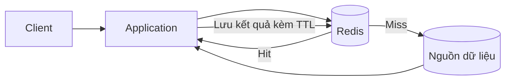

# Redis: tổng quan và môi trường seminar

Phạm vi: phần tổng quan của người phụ trách hạ tầng. Ngày đối chiếu nguồn: **20/10/2026**. Tập trung Redis server thông thường và các lệnh cốt lõi dùng trong repo; không giả định mọi tính năng trên tài liệu `latest` đều có trong gói Redis của Ubuntu.

## 1. Redis là gì?

Redis là một kho dữ liệu có cấu trúc, lưu tập dữ liệu hoạt động chủ yếu trong RAM và cho phép thao tác qua các lệnh. Key thường là chuỗi; value có thể là String, List, Hash, Sorted Set và nhiều kiểu khác. Ứng dụng có thể yêu cầu tăng bộ đếm, thêm phần tử vào hàng đợi hoặc cập nhật điểm trực tiếp trên server. Redis có thể đóng vai trò cache, database hoặc thành phần messaging tùy thiết kế. [S1, S2]

Seminar dùng Redis để minh họa bốn câu hỏi: lưu dữ liệu theo cấu trúc nào, khi nào cache giúp giảm công việc lặp, chuyện gì xảy ra khi bộ nhớ đầy, và dữ liệu phục hồi ra sao sau crash.

RAM là nơi phục vụ dữ liệu chính không có nghĩa là Redis không ghi đĩa. RDB chụp snapshot; AOF ghi lại thay đổi để phục hồi. Cũng có thể tắt persistence khi dữ liệu có thể dựng lại. [S3]

## 2. Vì sao cần caching?

Ví dụ: một trang sản phẩm liên tục đọc cùng một thông tin. Nếu mỗi lượt truy cập đều thực hiện lại một truy vấn hoặc phép tính tốn thời gian, hệ thống phải lặp lại công việc. Cache giữ một bản kết quả để dùng lại trong khoảng thời gian phù hợp. [S4]

- **Cache hit:** tìm thấy giá trị có thể dùng trong cache.
- **Cache miss:** không có giá trị trong cache; ứng dụng phải lấy dữ liệu từ nguồn hoặc tính lại.
- **TTL:** thời gian sống còn lại của key. Hết hạn thì key không còn khả dụng cho lần đọc tiếp theo. `TTL = -1` nghĩa là key có tồn tại nhưng không đặt hạn; `TTL = -2` nghĩa là key không tồn tại. [S5]
- **Invalidation:** xóa hoặc cập nhật cache khi dữ liệu nguồn thay đổi. TTL hỗ trợ giới hạn thời gian giữ bản cũ trong luồng đơn giản, nhưng không tự xử lý mọi race condition hoặc bảo đảm nhất quán mạnh. [S4]

### Luồng Cache-Aside ở mức tổng quan



Ứng dụng quyết định nhánh hit/miss và ghi cache. Redis không tự biết cách truy vấn database của ứng dụng. Demo 02 dùng `sleep` khoảng 300 ms để mô phỏng nguồn chậm; đây không phải phép đo hiệu năng một database thật.

### Cách giải thích lợi ích mà không phóng đại

Gọi `h` là tỷ lệ hit, `T_cache` là chi phí kiểm tra Redis và `T_source` là chi phí lấy dữ liệu nguồn. Với mô hình đơn giản, bỏ qua chi phí ghi cache và các hiệu ứng đồng thời:

```text
T_trung_bình ≈ T_cache + (1 - h) × T_source
```

Đây là mô hình giải thích, không phải kết quả benchmark. Cache hữu ích khi chi phí tránh được đủ lớn so với chi phí kiểm tra cache. Tỷ lệ hit thấp, dữ liệu đổi liên tục hoặc nguồn vốn rất nhanh có thể làm lợi ích nhỏ. Khi báo cáo demo, tính từ thời gian đo thật:

```text
Hệ số nhanh hơn = T_miss / T_hit
Phần trăm giảm thời gian = (T_miss - T_hit) / T_miss × 100%
```

Hai đại lượng trên khác nhau. Ghi rõ đơn vị ms, đo cùng một phạm vi xử lý, lặp lại nhiều lần và không đưa thời gian khởi động chương trình vào một nhánh duy nhất.

## 3. Redis và database chính

| Khía cạnh | Redis trong vai trò cache của demo | Database chính của ứng dụng |
|---|---|---|
| Mục đích | Dùng lại kết quả đọc | Giữ dữ liệu nguồn theo yêu cầu ứng dụng |
| Dữ liệu | Một phần dữ liệu thường được truy cập | Dữ liệu nghiệp vụ cần lưu |
| Khi key mất | Miss rồi dựng lại từ nguồn | Có thể là mất dữ liệu nghiệp vụ |
| Cập nhật | Cần chính sách TTL/invalidation | Ứng dụng cập nhật nguồn và xử lý giao dịch |
| Dung lượng | Cần quản lý RAM và eviction | Phụ thuộc hệ quản trị và thiết kế |

Đây là cách phân vai trong kiến trúc minh họa. Không nên suy ra rằng database quan hệ luôn đọc đĩa ở mỗi request: chúng cũng có buffer/cache. Redis cũng có thể làm nguồn dữ liệu chính khi thiết kế chấp nhận mô hình dữ liệu, durability và recovery tương ứng. [S1–S4]

## 4. Năm use case tham khảo

| Use case | Dữ liệu và thao tác minh họa | Nếu dữ liệu mất hoặc hết TTL |
|---|---|---|
| Cache sản phẩm | String JSON ở `cache:product:42`; `GET`, `SET ... EX` | Đọc lại nguồn, tốn thêm thời gian |
| Session | Hash theo session ID và TTL | Người dùng có thể phải đăng nhập lại; cần quyết định durability |
| Rate limiting | Bộ đếm theo người dùng/cửa sổ; `INCR` và TTL | Quota có thể bị đặt lại; cần chính sách khi Redis lỗi |
| Leaderboard | Sorted Set, member là người chơi, score là điểm | Dựng lại từ nguồn nếu có; nếu Redis giữ bản duy nhất thì cần persistence |
| Queue | List cho minh họa enqueue/dequeue | Pop rồi worker chết có thể làm mất việc nếu thiếu cơ chế xác nhận và phục hồi |

Rate limiter thực tế cần thao tác đọc/quyết định/cập nhật nguyên tử phù hợp; hai lệnh `INCR` và `EXPIRE` gửi rời không tự tạo thành một thao tác nguyên tử. Session có thể dùng TTL trượt khi ứng dụng chủ động gia hạn, không phải mọi lần đọc đều tự gia hạn. Queue đáng tin cậy cần cơ chế claim/ack, retry, theo dõi job đang chạy và xử lý trùng; List đơn giản chỉ minh họa cấu trúc. [S6–S9]

## 5. Redis nhanh nhờ đâu, và giới hạn nào?

Tóm tắt để giới thiệu, phần kiến trúc chi tiết do người phụ trách persistence trình bày:

- Phục vụ dữ liệu trong RAM và cung cấp thao tác trực tiếp trên cấu trúc dữ liệu giúp giảm công việc ở nhiều tình huống. [S2]
- Redis xử lý lệnh chủ yếu theo luồng thực thi chính trong mô hình được seminar khảo sát. Event loop quản lý nhiều kết nối; tùy phiên bản/cấu hình còn có I/O thread và các công việc nền. Không nói toàn bộ Redis chỉ có một thread. [S2]
- Lệnh nặng hoặc chạy lâu có thể tăng độ trễ của các client khác. Độ trễ còn phụ thuộc network, payload, client, CPU và persistence; không có một con số tốc độ đúng cho mọi workload. [S2]
- RAM hữu hạn. `maxmemory` và policy quyết định hành vi khi bộ nhớ chịu áp lực; `maxmemory` không phải giới hạn cứng cho toàn bộ RSS của process hoặc RAM của VM. [S10]
- Persistence cần đánh đổi giữa công việc ghi đĩa, fork/rewrite, thời gian phục hồi và cửa sổ mất dữ liệu. [S3]

## 6. Các rủi ro cần nhận biết

| Rủi ro | Ý nghĩa | Cách giới thiệu ở phần tổng quan |
|---|---|---|
| Stale data | Cache giữ bản cũ sau khi nguồn đổi | TTL/invalidation cần phù hợp nghiệp vụ |
| Cache stampede | Nhiều request cùng miss một key | Cần phối hợp refresh hoặc giới hạn request xuống nguồn |
| Cache penetration | Truy vấn nhiều dữ liệu không tồn tại | Có thể cân nhắc negative caching với TTL phù hợp |
| Redis không khả dụng | Cache lookup lỗi hoặc timeout | Cần quyết định fallback, timeout và sức chịu tải của nguồn |
| Eviction sai loại dữ liệu | Key quan trọng bị loại cùng cache | Tách instance/policy theo mục đích |
| Mất dữ liệu sau crash | Dữ liệu RAM mới chưa được lưu đủ bền | Cấu hình persistence và kiểm tra recovery |

Không chọn Redis làm bản duy nhất cho dữ liệu quan trọng khi chưa đánh giá mức mất dữ liệu chấp nhận được, backup và phục hồi. Bật AOF không đồng nghĩa với bảo đảm không mất dữ liệu. [S3, S4, S10]

## 7. Môi trường và bốn demo

| Nội dung | Port | Điều cần quan sát |
|---|---:|---|
| Dịch vụ mặc định | 6379 | Service hoạt động và `PING` trả `PONG` |
| Data structures và TTL | 6383 | Chọn đúng kiểu, thứ tự điểm, key tự hết hạn |
| Cache-Aside | 6384 | Cùng dữ liệu, nhánh miss/hit, thời gian thực đo |
| Eviction | 6382 | `maxmemory 10mb`, `allkeys-lru`, `evicted_keys` tăng |
| Persistence RDB/AOF | 6380/6381 | PID đúng, key trước/sau crash, dữ liệu trên đĩa |

Mỗi instance có port và thư mục riêng. Các config demo bind `127.0.0.1`, phù hợp chạy app trong cùng Linux guest. Không cần public Redis để thực hiện seminar. [S11]

Yêu cầu đề bài là VM Linux 512 MB RAM. VMware có thể thể hiện cấu hình này trực tiếp; WSL2 phù hợp rehearsal nhưng kết quả trên WSL không chứng minh đã chạy ở 512 MB. Ghi môi trường thật vào minh chứng; không điền cấu hình dự kiến thành kết quả đã kiểm tra.

`kill -9` mô phỏng Redis process crash, không loại bỏ page cache của kernel như mất điện cả máy. Vì vậy AOF có thể phục hồi hết key trong phép thử dù có cửa sổ rủi ro mất dữ liệu khi máy gặp sự cố. Không cố tạo kết quả mất dữ liệu bằng cách sửa log sau crash. [S3]

## 8. Câu hỏi thường gặp

**Đã có database, tại sao cần Redis?** Khi nhiều lần đọc lặp lại cùng dữ liệu, Redis có thể giữ kết quả để giảm công việc ở nguồn. Cần đo để biết có đáng chi phí vận hành và tính nhất quán hay không.

**Redis có ghi đĩa không?** Có, nếu bật RDB và/hoặc AOF. Tập dữ liệu đang phục vụ chủ yếu ở RAM; đĩa dùng cho persistence trong phạm vi seminar.

**Restart Redis có luôn mất dữ liệu không?** Không. Kết quả tùy persistence, dữ liệu đã ghi bền, loại shutdown và file được nạp khi khởi động.

**TTL có bảo đảm dữ liệu luôn mới không?** Không. TTL chỉ đặt hạn tồn tại của bản cache. Cần xử lý update/invalidation và các race condition nếu yêu cầu độ mới chặt chẽ.

**Redis có thể thay database không?** Có thể trong một số thiết kế, nhưng cần đánh giá mô hình dữ liệu và yêu cầu durability. Demo dùng Redis làm cache không chứng minh nó thay được mọi database.

**Vì sao phải tách instance?** Để reset, memory pressure hoặc crash một bài không tác động dữ liệu/process bài khác. Nhiều logical database trong cùng process không tạo mức cách ly này.

**AOF everysec luôn mất đúng một giây dữ liệu?** Không. Đây là chính sách fsync theo khoảng thời gian, không phải kết quả mất dữ liệu cố định. Phải mô tả loại crash và đo dữ liệu phục hồi thật.

## 9. Nội dung chọn đưa lên slides

Khoảng **5 phút, gồm video môi trường khoảng 90 giây**: định nghĩa Redis, một ví dụ caching, vài use case/giới hạn, giới thiệu bốn demo và cách ly môi trường. Đây là phần chọn lọc để nói; các mục chi tiết phía trên dùng nghiên cứu và trả lời câu hỏi.

Phần tổng quan chỉ nêu mục đích của data structures/TTL, Cache-Aside, eviction và persistence. Các thao tác, công thức đo, thuật toán và cơ chế phục hồi do chủ từng demo trình bày sau. Xem [ghi chú trình bày và quay](../docs/presentation-notes/01-overview-environment.md).

## Tài liệu tham khảo

Đối chiếu ngày 20/10/2026. Nguồn `latest` có thể thay đổi; đối chiếu thêm `redis-server --version` và `CONFIG GET` trên môi trường thực tế. Các con số marketing/benchmark trên trang use case không được dùng làm kết quả seminar.

- **S1:** [Redis quick starts](https://redis.io/docs/latest/develop/get-started/).
- **S2:** [Redis FAQ](https://redis.io/docs/latest/develop/get-started/faq/), đặc biệt mô hình dữ liệu, RAM và thread.
- **S3:** [Redis persistence](https://redis.io/docs/latest/operate/oss_and_stack/management/persistence/).
- **S4:** [Redis cache-aside](https://redis.io/docs/latest/develop/use-cases/cache-aside/).
- **S5:** [TTL command](https://redis.io/docs/latest/commands/ttl/) và [EXPIRE command](https://redis.io/docs/latest/commands/expire/).
- **S6:** [Redis session store](https://redis.io/docs/latest/develop/use-cases/session-store/).
- **S7:** [Redis rate limiter](https://redis.io/docs/latest/develop/use-cases/rate-limiter/).
- **S8:** [Redis leaderboard](https://redis.io/docs/latest/develop/use-cases/leaderboard/).
- **S9:** [Redis job queue](https://redis.io/docs/latest/develop/use-cases/job-queue/).
- **S10:** [Key eviction](https://redis.io/docs/latest/develop/reference/eviction/).
- **S11:** [Redis security](https://redis.io/docs/latest/operate/oss_and_stack/management/security/).

Phạm vi seminar và hình thức nộp dựa trên cập nhật nhóm ngày 20/10/2026, [bảng tham khảo](https://docs.google.com/spreadsheets/d/1S-zmFakws1dpSU-tIph9FXWWWU3b6bIZE_6woAXYPsc/edit?gid=560560451#gid=560560451) và [đề bài trong repo](../de_tai_seminar.md).
